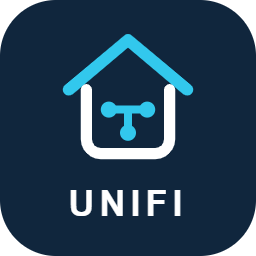

# UniFi Ingress CFM

Add-on experimental para abrir la interfaz de una consola UniFi OS local dentro de Home Assistant mediante Ingress. UniFi continúa ejecutándose en el router.

[Agregar repositorio a Home Assistant](https://my.home-assistant.io/redirect/supervisor_add_addon_repository/?repository_url=https%3A%2F%2Fgithub.com%2Fcarferrer%2Funifi-ingress-cfm)

## Instalación

1. Añade https://github.com/carferrer/unifi-ingress-cfm a los repositorios de la tienda de add-ons.
2. Instala **UniFi Ingress CFM**. Descarga la imagen precompilada para amd64 o aarch64.
3. Configura la URL HTTPS de tu consola y la huella SHA-256 de su certificado.
4. Inicia el add-on, pulsa **Abrir interfaz web** e inicia sesión con tu cuenta local de UniFi.

[Configuración y límites](unifi-ingress-preview/DOCS.md)

## Estado

Basado en la versión de pruebas 0.0.2, validada por su usuario con UCG Ultra, UniFi OS 5.1.19 y Network 10.4.57: acceso local, navegación, selector de iconos y reconexión de dispositivos. No implica compatibilidad con todos los modelos, versiones o funciones de UniFi.

Versión 2026.11.01: preparación para distribución, valores de conexión vacíos y documentación. El puente conserva el comportamiento de 0.0.2.

## Migración desde el ZIP local

Home Assistant considera la instalación desde este repositorio un add-on distinto del local. No es una actualización directa de la instalación ZIP.

Conserva tu URL y huella, detén el add-on local e instala el del repositorio con esos valores. Comprueba el acceso antes de borrar la prueba local. No se migra ni modifica la configuración del router. Tendrás que iniciar sesión de nuevo.

## Desarrollo

El proxy usa Node.js, Acorn y Magic String. No incluye ni redistribuye el JavaScript de UniFi: adapta las respuestas del router en memoria. No es un producto oficial de Ubiquiti ni de Home Assistant.

Las futuras actualizaciones se reciben al subir la versión del add-on en este repositorio. Las actualizaciones de UniFi no se incorporan automáticamente: requieren comprobar la compatibilidad del puente.

## Mantenimiento y releases

- **Renovate** propone PR para la imagen base, dependencias npm y acciones de GitHub, sin fusionarlas automáticamente. La aplicación Renovate debe tener acceso a este repositorio. No gestiona actualizaciones de UniFi OS/Network en el router.
- En **Actions → Preparar release → Run workflow**, introduce una versión mayor con formato YYYY.MM.NN, por ejemplo 2026.11.02. Abre una rama y PR con versión, lockfile y notas generadas desde GitHub.
- Revisa y fusiona esa PR en main. **Publicar release** valida la versión contra el commit fusionado, construye/prueba amd64 y aarch64, publica el manifiesto y finalmente crea el tag y release.
- También puedes ejecutar **Publicar release** manualmente para una versión ya preparada en main. Rechaza tags existentes y no modifica la release 2026.11.01.
- **CI** comprueba PR y cambios de main con builds de ambas arquitecturas sin publicar imágenes.
- GitHub debe permitir que Actions cree pull requests (Settings → Actions → General → Workflow permissions → Allow GitHub Actions to create and approve pull requests). El flujo no aprueba ni fusiona PR por sí mismo.
- Las PR creadas con GITHUB_TOKEN pueden no lanzar CI automáticamente. Puedes ejecutar CI manualmente eligiendo la rama release; Publicar release siempre vuelve a construir y probar antes de publicar.
- Build images es un workflow reutilizable invocado por Publicar release; los cambios ordinarios en main ya no publican versiones.

Referencias: [gestores regex de Renovate](https://docs.renovatebot.com/modules/manager/regex/) y [workflows reutilizables de GitHub](https://docs.github.com/en/actions/how-tos/reuse-automations/reuse-workflows).
